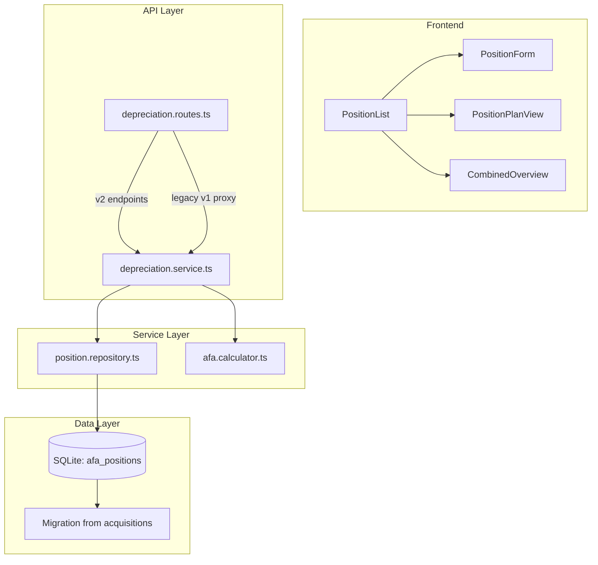
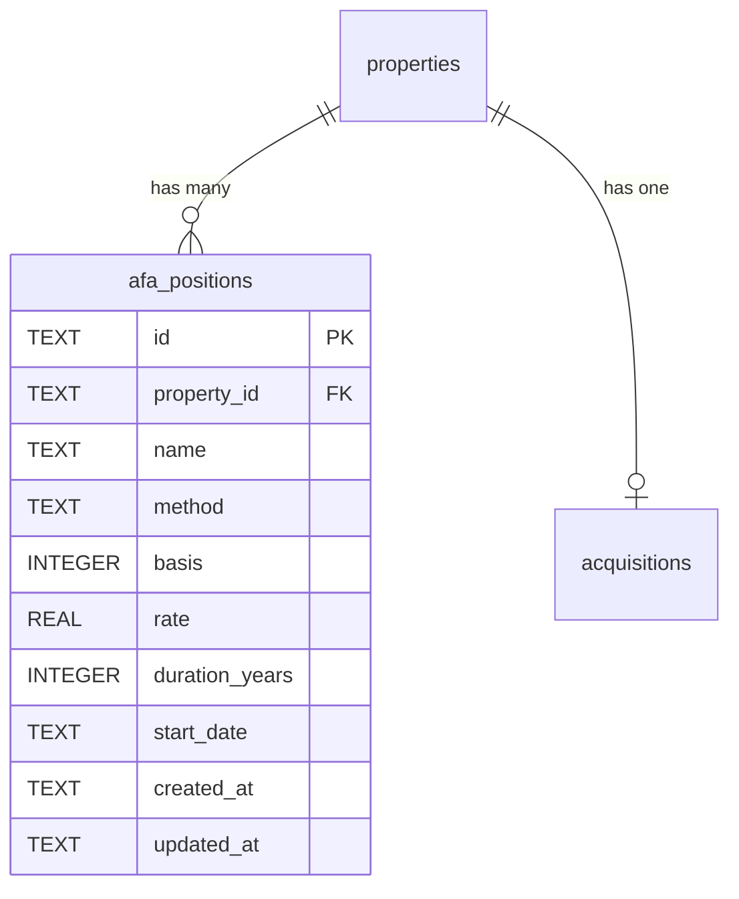

# Design Document: AfA Multi-Position & Degressive Abschreibung

## Overview

This feature extends the existing single-position linear depreciation module into a fully-featured multi-position system with support for both linear and degressive depreciation methods. The core insight is that the existing `afa.calculator.ts` already provides pure, well-tested functions for linear depreciation — we will extend this with a degressive calculator while introducing a new `afa_positions` table to hold per-position data instead of piggy-backing on the `acquisitions` table.

### Design Goals

1. **Backward compatibility** — existing API endpoints (`/api/v1/depreciation/:propertyId`) continue to work by proxying to the migrated "Gebäude" position.
2. **Pure calculation layer** — all plan generation remains in pure functions, easy to test with property-based testing (fast-check).
3. **Minimal migration risk** — a SQL migration script moves data from `acquisitions.afa_*` columns into `afa_positions` rows, keeping original columns as read-only legacy.
4. **Extensibility** — adding a future "Sonder-AfA" or "Leistungs-AfA" method requires only a new calculator function and a new method enum value.

## Architecture



The architecture follows the existing module pattern: **Routes → Service → Repository + Calculator**. The calculator remains a pure-function module with zero database or I/O dependencies.

### Key Design Decisions

| Decision | Choice | Rationale |
|----------|--------|-----------|
| Storage model | New `afa_positions` table | Decouples depreciation positions from acquisition data; supports N positions per property |
| Calculator purity | Separate pure functions per method | Enables fast property-based testing without DB setup |
| Legacy API | Proxy via "Gebäude" position | Zero-downtime migration; old frontend continues working |
| Rate input | Accept both rate and duration_years | UX convenience; duration is converted server-side |
| Monetary precision | All amounts as integer cents | Prevents floating-point errors in financial calculations |

## Components and Interfaces

### 1. Calculator Module — `afa.calculator.ts`

Extended with degressive calculation. Existing functions remain unchanged.

```typescript
// --- Existing (unchanged) ---
export function calculateAnnualAfa(basis: number, rate: number): number;
export function calculateFirstYearAfa(annualAmount: number, startMonth: number): number;
export function generateAfaPlan(basis: number, rate: number, startDate: string): AfaPlanEntry[];

// --- New ---
export type DepreciationMethod = 'linear' | 'degressiv';

export interface AfaPlanEntry {
  year: number;
  annualAmount: number;       // in cents
  cumulativeAmount: number;   // in cents
  residualValue: number;      // in cents
}

/**
 * Generate degressive AfA plan.
 * Each year: amount = round(currentResidual * rate)
 * First year: pro rata temporis based on start month.
 * Terminates when residual rounds to 0.
 */
export function generateDegressiveAfaPlan(
  basis: number,
  rate: number,
  startDate: string
): AfaPlanEntry[];

/**
 * Unified entry point — dispatches to linear or degressive.
 */
export function generateAfaPlanByMethod(
  method: DepreciationMethod,
  basis: number,
  rate: number,
  startDate: string
): AfaPlanEntry[];

/**
 * Convert duration in years to rate (for linear method).
 * rate = 1 / durationYears
 */
export function durationToRate(durationYears: number): number;
```

### 2. Repository — `position.repository.ts`

New file: `backend/src/modules/depreciation/position.repository.ts`

```typescript
export interface AfaPositionRecord {
  id: string;
  property_id: string;
  name: string;                     // e.g. "Gebäude", "Einbauküche"
  method: 'linear' | 'degressiv';
  basis: number;                    // cents
  rate: number;                     // decimal, e.g. 0.02
  duration_years: number | null;    // optional, for linear convenience
  start_date: string;               // ISO YYYY-MM-DD
  created_at: string;
  updated_at: string;
}

export interface CreatePositionInput {
  property_id: string;
  name: string;
  method: 'linear' | 'degressiv';
  basis: number;
  rate: number;
  duration_years: number | null;
  start_date: string;
}

export interface UpdatePositionInput {
  name?: string;
  method?: 'linear' | 'degressiv';
  basis?: number;
  rate?: number;
  duration_years?: number | null;
  start_date?: string;
}

export class PositionRepository {
  constructor(private db: Database) {}

  findAllByPropertyId(propertyId: string): AfaPositionRecord[];
  findById(id: string): AfaPositionRecord | undefined;
  countByPropertyId(propertyId: string): number;
  nameExistsForProperty(propertyId: string, name: string, excludeId?: string): boolean;
  create(input: CreatePositionInput): AfaPositionRecord;
  update(id: string, input: UpdatePositionInput): AfaPositionRecord;
  delete(id: string): void;
}
```

### 3. Service — `depreciation.service.ts` (Extended)

The service gains new methods while keeping old ones for backward compat:

```typescript
export class DepreciationService {
  // --- Legacy (kept for backward compatibility) ---
  getAfaParameters(propertyId: string, userId: string): AfaParameters;
  updateAfaParameters(propertyId: string, userId: string, input: UpdateAfaParametersInput): AfaParameters;
  getAfaPlan(propertyId: string, userId: string): { parameters: AfaParameters; plan: AfaPlanEntry[] };

  // --- New multi-position methods ---
  listPositions(propertyId: string, userId: string): AfaPositionRecord[];
  createPosition(propertyId: string, userId: string, input: CreatePositionInput): AfaPositionRecord;
  updatePosition(positionId: string, userId: string, input: UpdatePositionInput): AfaPositionRecord;
  deletePosition(positionId: string, userId: string): void;
  getPositionPlan(positionId: string, userId: string): { position: AfaPositionRecord; plan: AfaPlanEntry[] };
  getCombinedOverview(propertyId: string, userId: string): CombinedAfaOverview;
}

export interface CombinedAfaYearEntry {
  year: number;
  totalAmount: number;                          // sum across all positions
  positions: { positionId: string; name: string; amount: number }[];
}

export interface CombinedAfaOverview {
  propertyId: string;
  years: CombinedAfaYearEntry[];
}
```

### 4. Routes — `depreciation.routes.ts` (Extended)

New endpoints alongside existing ones:

| Method | Path | Description |
|--------|------|-------------|
| GET | `/api/v1/depreciation/:propertyId` | Legacy — returns "Gebäude" position params |
| PUT | `/api/v1/depreciation/:propertyId` | Legacy — updates "Gebäude" position |
| GET | `/api/v1/depreciation/:propertyId/plan` | Legacy — returns "Gebäude" plan |
| GET | `/api/v1/depreciation/:propertyId/positions` | List all positions |
| POST | `/api/v1/depreciation/:propertyId/positions` | Create new position |
| PUT | `/api/v1/depreciation/:propertyId/positions/:positionId` | Update position |
| DELETE | `/api/v1/depreciation/:propertyId/positions/:positionId` | Delete position |
| GET | `/api/v1/depreciation/:propertyId/positions/:positionId/plan` | Plan for single position |
| GET | `/api/v1/depreciation/:propertyId/combined` | Combined yearly overview |

### 5. Validators — `depreciation.validators.ts` (New)

Zod schemas for request validation:

```typescript
export const createPositionSchema = z.object({
  name: z.string().min(1).max(100),
  method: z.enum(['linear', 'degressiv']),
  basis: z.number().int().positive(),
  rate: z.number().min(0.0001).max(1.0).optional(),
  duration_years: z.number().int().min(1).max(100).optional(),
  start_date: z.string().regex(/^\d{4}-\d{2}-\d{2}$/),
}).refine(
  (data) => data.rate !== undefined || (data.method === 'linear' && data.duration_years !== undefined),
  { message: 'Either rate or duration_years (for linear) must be provided' }
);

export const updatePositionSchema = createPositionSchema.partial();
```

## Data Models

### New Table: `afa_positions`

```sql
CREATE TABLE afa_positions (
  id TEXT PRIMARY KEY,
  property_id TEXT NOT NULL REFERENCES properties(id) ON DELETE CASCADE,
  name TEXT NOT NULL CHECK(length(name) >= 1 AND length(name) <= 100),
  method TEXT NOT NULL CHECK(method IN ('linear', 'degressiv')),
  basis INTEGER NOT NULL CHECK(basis > 0),
  rate REAL NOT NULL CHECK(rate >= 0.0001 AND rate <= 1.0),
  duration_years INTEGER CHECK(duration_years IS NULL OR (duration_years >= 1 AND duration_years <= 100)),
  start_date TEXT NOT NULL,
  created_at TEXT NOT NULL,
  updated_at TEXT NOT NULL,
  UNIQUE(property_id, name)
);

CREATE INDEX idx_afa_positions_property_id ON afa_positions(property_id);
```

### Migration Script (002_afa_positions.sql)

```sql
-- Create the new afa_positions table
CREATE TABLE afa_positions (
  id TEXT PRIMARY KEY,
  property_id TEXT NOT NULL REFERENCES properties(id) ON DELETE CASCADE,
  name TEXT NOT NULL CHECK(length(name) >= 1 AND length(name) <= 100),
  method TEXT NOT NULL CHECK(method IN ('linear', 'degressiv')),
  basis INTEGER NOT NULL CHECK(basis > 0),
  rate REAL NOT NULL CHECK(rate >= 0.0001 AND rate <= 1.0),
  duration_years INTEGER CHECK(duration_years IS NULL OR (duration_years >= 1 AND duration_years <= 100)),
  start_date TEXT NOT NULL,
  created_at TEXT NOT NULL,
  updated_at TEXT NOT NULL,
  UNIQUE(property_id, name)
);

CREATE INDEX idx_afa_positions_property_id ON afa_positions(property_id);

-- Migrate existing data: create "Gebäude" position for each acquisition with afa_basis > 0
INSERT INTO afa_positions (id, property_id, name, method, basis, rate, duration_years, start_date, created_at, updated_at)
SELECT
  lower(hex(randomblob(4)) || '-' || hex(randomblob(2)) || '-4' || substr(hex(randomblob(2)),2) || '-' || substr('89ab', abs(random()) % 4 + 1, 1) || substr(hex(randomblob(2)),2) || '-' || hex(randomblob(6))),
  property_id,
  'Gebäude',
  'linear',
  afa_basis,
  COALESCE(afa_rate, 0.02),
  NULL,
  COALESCE(afa_start_date, purchase_date),
  datetime('now'),
  datetime('now')
FROM acquisitions
WHERE afa_basis > 0;
```

### Entity Relationships



## Correctness Properties

*A property is a characteristic or behavior that should hold true across all valid executions of a system — essentially, a formal statement about what the system should do. Properties serve as the bridge between human-readable specifications and machine-verifiable correctness guarantees.*

### Property 1: Position data round-trip

*For any* valid AfA position input (name, method, basis, rate, start_date), creating the position and then reading it back should return all fields with identical values.

**Validates: Requirements 1.2, 3.1**

### Property 2: Unique name enforcement

*For any* valid position name, creating two AfA positions with the same name for the same property should succeed for the first and fail with a validation error for the second.

**Validates: Requirements 1.5, 8.6**

### Property 3: Duration to rate conversion

*For any* valid duration in years (1–100), `durationToRate(n)` should produce a rate equal to `1 / n`, and this rate applied linearly should fully depreciate the basis in exactly `n` full years (plus potential first/last year adjustments).

**Validates: Requirements 3.3**

### Property 4: Linear plan — middle years amount consistency

*For any* valid basis, rate, and start date, all entries in the linear AfA plan except the first and last year should have `annualAmount` equal to `round(basis × rate)`.

**Validates: Requirements 4.1**

### Property 5: Linear plan — total sum equals basis

*For any* valid basis, rate, and start date, the sum of all `annualAmount` values in the linear AfA plan should equal the `basis` exactly (ensuring no cent is lost or gained).

**Validates: Requirements 4.5**

### Property 6: Pro-rata temporis first year (both methods)

*For any* valid basis, rate, and start date where the start month is not January, the first year's `annualAmount` should equal `round(fullYearAmount × remainingMonths / 12)` where `remainingMonths = 12 - startMonth + 1` — this must hold for both the linear and degressive methods.

**Validates: Requirements 2.3, 4.4**

### Property 7: Degressive plan — annual amount formula

*For any* valid basis, rate, and start date, each entry in the degressive AfA plan (after the first year) should have `annualAmount` equal to `round(previousResidualValue × rate)`.

**Validates: Requirements 2.2, 4.2**

### Property 8: Degressive plan — terminates at zero

*For any* valid basis, rate, and start date, the degressive AfA plan should terminate with the last entry having `residualValue = 0`.

**Validates: Requirements 2.4**

### Property 9: Degressive plan — strict monotonicity

*For any* valid basis, rate, and start date producing a degressive plan, the `cumulativeAmount` values should be strictly increasing and the `residualValue` values should be strictly decreasing across all entries.

**Validates: Requirements 4.7**

### Property 10: Combined overview — total equals sum of positions

*For any* set of AfA positions belonging to a property, the combined yearly overview's `totalAmount` for each year should equal the sum of each individual position's `annualAmount` for that year.

**Validates: Requirements 5.1, 5.2**

### Property 11: Combined overview — zero contribution outside active range

*For any* AfA position with a given start date and plan duration, the combined overview should show a contribution of `0` for that position in all years before its start year and all years after its plan has ended (residual = 0).

**Validates: Requirements 5.3, 5.4**

### Property 12: Name length validation

*For any* string that is empty (length 0) or exceeds 100 characters, attempting to create an AfA position with that string as the name should be rejected with a validation error.

**Validates: Requirements 8.1**

## Error Handling

| Scenario | HTTP Status | Error Message (German) |
|----------|-------------|------------------------|
| Property not found / not owned by user | 403 | "Zugriff verweigert" |
| Position not found | 404 | "AfA-Position nicht gefunden" |
| Duplicate position name | 409 | "Eine Position mit diesem Namen existiert bereits" |
| Max 20 positions reached | 400 | "Maximal 20 AfA-Positionen pro Objekt erlaubt" |
| Cannot delete last position | 400 | "Mindestens eine AfA-Position muss vorhanden sein" |
| Invalid basis (≤ 0) | 400 | "Bemessungsgrundlage muss größer als 0 sein" |
| Invalid rate (out of range) | 400 | "AfA-Satz muss zwischen 0,01% und 100% liegen" |
| Invalid date format | 400 | "Ungültiges Datumsformat (erwartet: YYYY-MM-DD)" |
| Invalid method | 400 | "Abschreibungsmethode muss 'linear' oder 'degressiv' sein" |
| Name too long / empty | 400 | "Positionsname muss zwischen 1 und 100 Zeichen lang sein" |
| Duration out of range | 400 | "Nutzungsdauer muss zwischen 1 und 100 Jahren liegen" |
| Neither rate nor duration provided | 400 | "AfA-Satz oder Nutzungsdauer muss angegeben werden" |

Error responses follow the existing pattern:

```typescript
interface ErrorResponse {
  statusCode: number;
  error: string;
  message: string;
}
```

Errors are thrown with a `statusCode` property and caught by Fastify's error handler, consistent with the existing codebase pattern.

## Testing Strategy

### Property-Based Tests (fast-check)

The calculator module (`afa.calculator.ts`) contains pure functions perfectly suited for property-based testing. Each correctness property above maps to a fast-check test with minimum 100 iterations.

**Library:** `fast-check` (already in project dependencies with Vitest)

**Test file:** `backend/src/modules/depreciation/afa.calculator.property.test.ts`

Each test will be tagged with:
```
// Feature: afa-multi-position-degressiv, Property N: <property text>
```

**Properties to implement:**
1. Position data round-trip (service-level, needs mock DB)
2. Unique name enforcement (service-level)
3. Duration to rate conversion (pure function)
4. Linear plan middle years consistency (pure function)
5. Linear plan total = basis (pure function)
6. Pro-rata first year for both methods (pure function)
7. Degressive annual amount formula (pure function)
8. Degressive termination at zero (pure function)
9. Degressive strict monotonicity (pure function)
10. Combined overview total = sum (pure function operating on plan arrays)
11. Zero contribution outside active range (pure function)
12. Name length validation (validator function)

Properties 3–11 operate on pure functions and require no mocking — ideal for fast-check.
Properties 1–2 and 12 test the validation/service layer and can use fast-check with in-memory DB setup.

**Generators needed:**
- `arbBasis`: positive integer (1–100_000_000 cents, i.e., up to 1M EUR)
- `arbRate`: float in [0.0001, 1.0]
- `arbStartDate`: valid ISO date string with year in [2000, 2040] and month in [1, 12]
- `arbMethod`: one of `'linear' | 'degressiv'`
- `arbPositionName`: string with length [1, 100]
- `arbDurationYears`: integer in [1, 100]

### Unit Tests (Vitest)

**Test files:**
- `afa.calculator.test.ts` — extend existing tests for degressive functions
- `depreciation.service.test.ts` — new, for service-level CRUD and business logic
- `depreciation.routes.test.ts` — integration tests for HTTP endpoints

**Coverage targets:**
- Edge cases: max positions (20), deletion of last position, boundary rates, December start month
- Error paths: all validation errors, 403/404 scenarios
- Migration: verify data integrity after running migration script
- Backward compat: legacy endpoints continue working after migration

### Integration Tests

- Full API flow: create property → create positions → get plans → get combined overview
- Migration script: run on test DB with seeded data, verify correct "Gebäude" positions
- Legacy proxy: call old endpoints, verify they return data from migrated position

