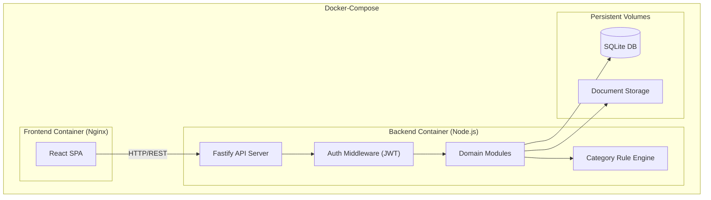
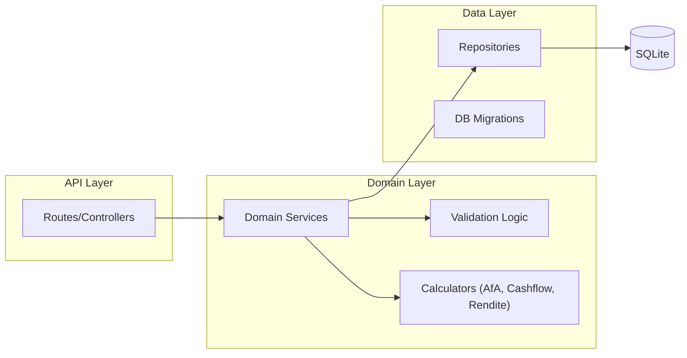
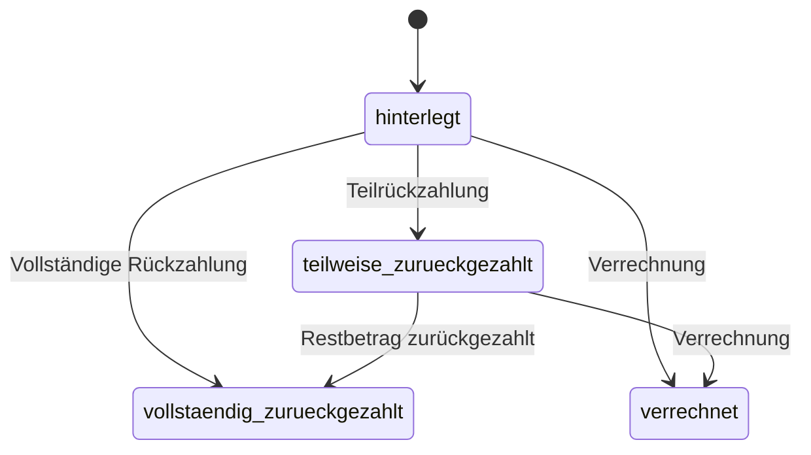
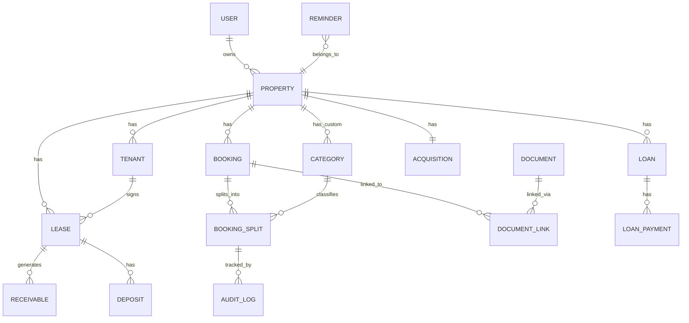

# Design Document: Vermieter Kapitalanlagen Manager

## Overview

Der Vermieter Kapitalanlagen Manager ist eine modulare Webanwendung zur Verwaltung vermieteter Eigentumswohnungen als Kapitalanlage. Das System ermöglicht privaten Vermietern die vollständige Erfassung, Kategorisierung und Auswertung von Einnahmen, Ausgaben, Finanzierungen und steuerlich relevanten Daten über multiple Objekte hinweg.

### Technologieentscheidungen

| Schicht | Technologie | Begründung |
|---------|-------------|------------|
| Frontend | React + TypeScript + TailwindCSS | Type-Safety, komponentenbasierte UI, schnelles Styling |
| Backend | Node.js + Fastify | Hohe Performance, Schema-basierte Validierung, Plugin-Architektur |
| Datenbank | SQLite (via better-sqlite3) | Einfaches Deployment, kein separater DB-Server, ausreichend für Single-User/Small-Team |
| Datei-Storage | Lokales Filesystem / S3-kompatibel | Konfigurierbar je nach Deployment |
| Auth | Email/Password + JWT (Access + Refresh Token) | Stateless Auth, einfache Implementierung |
| Deployment | Docker-Compose | Frontend (Nginx), Backend (Node), Volumes für DB + Dateien |

### Designprinzipien

- **Domänenbasierte Modularität**: Jede Domäne (Objekt, Mieter, Buchung, AfA, etc.) ist ein eigenständiges Modul mit eigenen Routes, Services und Repositories.
- **Schichttrennung**: UI ↔ API (Controller/Routes) ↔ Domain Logic (Services) ↔ Data Access (Repositories) ↔ SQLite.
- **Regelwerk als Daten**: Kategorien und ihre Klassifikationsregeln werden in konfigurierbaren Tabellen gespeichert, nicht im Code hartcodiert.
- **Split-Booking-Architektur**: Jede Buchung kann in Teilbuchungen zerlegt werden; die Summe der Teile muss centgenau dem Gesamtbetrag entsprechen.
- **Mehrobjektfähigkeit ab Tag 1**: Jede Entität ist über einen Foreign Key an ein Objekt gebunden.
- **Audit-Trail**: Klassifikationsänderungen werden unveränderlich protokolliert.

## Architecture

### Systemarchitektur (Container-Ebene)



### Backend-Modulstruktur



### Domänenmodule

| Modul | Verantwortlichkeit |
|-------|-------------------|
| `auth` | Registrierung, Login, JWT-Ausgabe, Passwort-Hashing |
| `property` | Objekte (Immobilien) CRUD, Kaufpreisaufteilung |
| `tenant` | Mieter CRUD |
| `lease` | Mietverträge, Mietmodelle, Sollstellungen |
| `deposit` | Kautionsverwaltung mit Statusübergängen |
| `income` | Einnahmenerfassung, Soll/Ist-Vergleich |
| `expense` | Ausgaben mit Split-Buchungen |
| `category` | Kategorien-CRUD, Regelwerk |
| `depreciation` | AfA-Berechnung, AfA-Plan-Generierung |
| `loan` | Darlehen CRUD, Zahlungen, Restschuld |
| `cashflow` | Cashflow-Berechnung, Renditekennzahlen |
| `utility-billing` | Nebenkostenabrechnung, Umlageschlüssel |
| `document` | Upload, Verknüpfung, Suche |
| `reminder` | Erinnerungen, Wiederkehrend, Status |
| `report` | Berichte, PDF/CSV/Excel-Export |
| `dashboard` | KPI-Aggregation |
| `settings` | Benutzerprofil, Passwort |
| `audit-log` | Unveränderliche Protokollierung |

## Components and Interfaces

### API-Design (REST)

Alle Endpunkte sind unter `/api/v1/` gruppiert und erfordern JWT-Authentifizierung (außer `/api/v1/auth/login` und `/api/v1/auth/register`).

#### Auth
```
POST   /api/v1/auth/register
POST   /api/v1/auth/login
POST   /api/v1/auth/refresh
```

#### Properties (Objekte)
```
GET    /api/v1/properties
POST   /api/v1/properties
GET    /api/v1/properties/:id
PUT    /api/v1/properties/:id
DELETE /api/v1/properties/:id
GET    /api/v1/properties/:id/acquisition   (Anschaffungsdaten)
PUT    /api/v1/properties/:id/acquisition
```

#### Tenants (Mieter)
```
GET    /api/v1/tenants?propertyId=
POST   /api/v1/tenants
GET    /api/v1/tenants/:id
PUT    /api/v1/tenants/:id
DELETE /api/v1/tenants/:id
```

#### Leases (Mietverträge)
```
GET    /api/v1/leases?propertyId=
POST   /api/v1/leases
GET    /api/v1/leases/:id
PUT    /api/v1/leases/:id
POST   /api/v1/leases/:id/terminate
GET    /api/v1/leases/:id/receivables    (Sollstellungen)
```

#### Deposits (Kautionen)
```
GET    /api/v1/deposits?leaseId=
POST   /api/v1/deposits
GET    /api/v1/deposits/:id
POST   /api/v1/deposits/:id/refund
```

#### Income (Einnahmen)
```
GET    /api/v1/income?propertyId=&year=&month=
POST   /api/v1/income
GET    /api/v1/income/:id
PUT    /api/v1/income/:id
DELETE /api/v1/income/:id
GET    /api/v1/income/comparison?leaseId=&year=&month=  (Soll/Ist)
```

#### Expenses (Ausgaben)
```
GET    /api/v1/expenses?propertyId=&year=&categoryId=&flags=
POST   /api/v1/expenses
GET    /api/v1/expenses/:id
PUT    /api/v1/expenses/:id
DELETE /api/v1/expenses/:id
POST   /api/v1/expenses/:id/split       (Split-Buchung anlegen)
PUT    /api/v1/expenses/:id/split       (Split-Buchung bearbeiten)
```

#### Categories (Kategorien)
```
GET    /api/v1/categories?propertyId=
POST   /api/v1/categories
PUT    /api/v1/categories/:id
POST   /api/v1/categories/:id/deactivate
```

#### Depreciation (AfA)
```
GET    /api/v1/depreciation/:propertyId
PUT    /api/v1/depreciation/:propertyId     (AfA-Parameter setzen)
GET    /api/v1/depreciation/:propertyId/plan (AfA-Plan generieren)
```

#### Loans (Darlehen)
```
GET    /api/v1/loans?propertyId=
POST   /api/v1/loans
GET    /api/v1/loans/:id
PUT    /api/v1/loans/:id
DELETE /api/v1/loans/:id
POST   /api/v1/loans/:id/payments
GET    /api/v1/loans/:id/payments
GET    /api/v1/loans/:id/balance         (Restschuldverlauf)
```

#### Cashflow & Rendite
```
GET    /api/v1/cashflow?propertyId=&year=
GET    /api/v1/yield?propertyId=
```

#### Utility Billing (Nebenkosten)
```
POST   /api/v1/utility-billing
GET    /api/v1/utility-billing/:id
GET    /api/v1/utility-billing/:id/pdf
```

#### Documents
```
POST   /api/v1/documents/upload
GET    /api/v1/documents?search=&propertyId=
GET    /api/v1/documents/:id
DELETE /api/v1/documents/:id
POST   /api/v1/documents/:id/link
```

#### Reminders (Erinnerungen)
```
GET    /api/v1/reminders?propertyId=&status=
POST   /api/v1/reminders
PUT    /api/v1/reminders/:id
POST   /api/v1/reminders/:id/complete
POST   /api/v1/reminders/:id/postpone
```

#### Reports
```
GET    /api/v1/reports/:type?propertyId=&year=&format=
```

#### Dashboard
```
GET    /api/v1/dashboard?propertyId=
```

#### Settings
```
GET    /api/v1/settings/profile
PUT    /api/v1/settings/profile
POST   /api/v1/settings/password
```

#### Audit Log
```
GET    /api/v1/audit-log?bookingId=&from=&to=&type=&page=&limit=
```

### Frontend-Komponentenstruktur

```
src/
├── app/
│   ├── App.tsx
│   ├── Router.tsx
│   └── AuthProvider.tsx
├── features/
│   ├── dashboard/
│   ├── properties/
│   ├── tenants/
│   ├── leases/
│   ├── deposits/
│   ├── income/
│   ├── expenses/
│   ├── categories/
│   ├── depreciation/
│   ├── loans/
│   ├── cashflow/
│   ├── utility-billing/
│   ├── documents/
│   ├── reminders/
│   ├── reports/
│   └── settings/
├── shared/
│   ├── components/    (Button, Input, Table, Modal, Card, etc.)
│   ├── hooks/         (useAuth, useApi, usePropertyFilter)
│   ├── utils/         (formatting, validation, german-number-format)
│   └── types/
└── i18n/
    └── de.ts          (Deutsche UI-Texte)
```

### Schlüsselkomponenten

#### Rule Engine (Category Service)
```typescript
interface CategoryRule {
  id: string;
  name: string;
  type: 'income' | 'expense';
  isAllocable: boolean;           // umlagefähig
  isTaxDeductible: boolean;       // steuerlich abziehbar
  requiresCapitalization: boolean; // aktivierungspflichtig
  isFinancingRelated: boolean;    // finanzierungsbezogen
  isSystem: boolean;              // Standardkategorie vs. benutzerdefiniert
  isActive: boolean;
}

interface BookingSplit {
  id: string;
  bookingId: string;
  amount: number;                  // in Cents
  categoryId: string;
  isAllocable: boolean;
  isTaxDeductible: boolean;
  requiresCapitalization: boolean;
  isFinancingRelated: boolean;
  overriddenFlags: string[];       // welche Flags manuell überschrieben
}
```

#### AfA Calculator
```typescript
interface AfaInput {
  assessmentBasis: number;    // AfA-Bemessungsgrundlage in Cents
  rate: number;               // AfA-Satz als Dezimalzahl (z.B. 0.02 für 2%)
  startDate: Date;            // Beginn der AfA
}

interface AfaPlanEntry {
  year: number;
  annualAmount: number;       // Jahres-AfA in Cents
  cumulativeAmount: number;   // Kumulierte AfA in Cents
  residualValue: number;      // Restwert in Cents
}

function calculateAfaPlan(input: AfaInput): AfaPlanEntry[];
```

#### Cashflow Calculator
```typescript
interface CashflowResult {
  month: number;
  year: number;
  incomeTotal: number;
  expensesWithoutRepayment: number;
  repaymentTotal: number;
  cashflowBeforeRepayment: number;
  cashflowAfterRepayment: number;
}

interface YieldResult {
  grossYield: number;    // Bruttomietrendite in %
  netYield: number;      // Nettomietrendite in %
}
```

#### Deposit State Machine


## Data Models

### ER-Diagramm (Kernentitäten)



### Tabellenstrukturen

#### users
| Spalte | Typ | Constraints |
|--------|-----|-------------|
| id | TEXT (UUID) | PRIMARY KEY |
| email | TEXT | UNIQUE, NOT NULL |
| password_hash | TEXT | NOT NULL |
| name | TEXT(100) | NOT NULL |
| created_at | TEXT (ISO 8601) | NOT NULL |
| updated_at | TEXT (ISO 8601) | NOT NULL |

#### properties
| Spalte | Typ | Constraints |
|--------|-----|-------------|
| id | TEXT (UUID) | PRIMARY KEY |
| user_id | TEXT | FK → users, NOT NULL |
| name | TEXT(100) | NOT NULL |
| street | TEXT(150) | NOT NULL |
| zip_code | TEXT(5) | NOT NULL, CHECK(length=5, all digits) |
| city | TEXT(100) | NOT NULL |
| property_type | TEXT | NOT NULL, CHECK IN ('Wohnung','Haus','Gewerbe','Garage','Grundstück') |
| living_area_sqm | REAL | NOT NULL, CHECK(1..99999) |
| created_at | TEXT | NOT NULL |
| updated_at | TEXT | NOT NULL |

#### acquisitions
| Spalte | Typ | Constraints |
|--------|-----|-------------|
| id | TEXT (UUID) | PRIMARY KEY |
| property_id | TEXT | FK → properties, UNIQUE, NOT NULL |
| purchase_price | INTEGER | NOT NULL (Cents), CHECK > 0 |
| purchase_date | TEXT | NOT NULL |
| transfer_date | TEXT | |
| notary_cost | INTEGER | DEFAULT 0 (Cents) |
| transfer_tax | INTEGER | DEFAULT 0 (Cents) |
| land_registry_cost | INTEGER | DEFAULT 0 (Cents) |
| broker_cost | INTEGER | DEFAULT 0 (Cents) |
| building_share | INTEGER | NOT NULL (Cents) |
| land_share | INTEGER | NOT NULL (Cents) |
| afa_basis | INTEGER | NOT NULL (Cents, computed) |
| afa_rate | REAL | (z.B. 0.02) |
| afa_start_date | TEXT | |

#### tenants
| Spalte | Typ | Constraints |
|--------|-----|-------------|
| id | TEXT (UUID) | PRIMARY KEY |
| property_id | TEXT | FK → properties, NOT NULL |
| first_name | TEXT(50) | NOT NULL |
| last_name | TEXT(50) | NOT NULL |
| email | TEXT | |
| phone | TEXT | |
| address | TEXT | |
| created_at | TEXT | NOT NULL |
| updated_at | TEXT | NOT NULL |

#### leases
| Spalte | Typ | Constraints |
|--------|-----|-------------|
| id | TEXT (UUID) | PRIMARY KEY |
| property_id | TEXT | FK → properties, NOT NULL |
| tenant_id | TEXT | FK → tenants, NOT NULL |
| start_date | TEXT | NOT NULL |
| end_date | TEXT | |
| cold_rent | INTEGER | NOT NULL (Cents), CHECK > 0 |
| operating_cost_advance | INTEGER | DEFAULT 0 (Cents) |
| heating_cost_advance | INTEGER | DEFAULT 0 (Cents) |
| due_day | INTEGER | NOT NULL, CHECK(1..28) |
| rent_model | TEXT | NOT NULL, CHECK IN ('konstant','staffel','index','manuell') |
| status | TEXT | NOT NULL, CHECK IN ('aktiv','beendet') |
| created_at | TEXT | NOT NULL |
| updated_at | TEXT | NOT NULL |

#### receivables (Sollstellungen)
| Spalte | Typ | Constraints |
|--------|-----|-------------|
| id | TEXT (UUID) | PRIMARY KEY |
| lease_id | TEXT | FK → leases, NOT NULL |
| property_id | TEXT | FK → properties, NOT NULL |
| due_date | TEXT | NOT NULL |
| cold_rent | INTEGER | NOT NULL (Cents) |
| operating_cost | INTEGER | NOT NULL (Cents) |
| heating_cost | INTEGER | NOT NULL (Cents) |
| total_amount | INTEGER | NOT NULL (Cents) |
| paid_amount | INTEGER | DEFAULT 0 (Cents) |
| status | TEXT | NOT NULL, CHECK IN ('offen','bezahlt','teilbezahlt','überfällig','storniert') |

#### deposits
| Spalte | Typ | Constraints |
|--------|-----|-------------|
| id | TEXT (UUID) | PRIMARY KEY |
| lease_id | TEXT | FK → leases, NOT NULL |
| property_id | TEXT | FK → properties, NOT NULL |
| amount | INTEGER | NOT NULL (Cents) |
| received_date | TEXT | NOT NULL |
| account_reference | TEXT(34) | NOT NULL |
| status | TEXT | NOT NULL, CHECK IN ('hinterlegt','teilweise_zurueckgezahlt','vollstaendig_zurueckgezahlt','verrechnet') |
| refunded_amount | INTEGER | DEFAULT 0 (Cents) |
| created_at | TEXT | NOT NULL |

#### bookings
| Spalte | Typ | Constraints |
|--------|-----|-------------|
| id | TEXT (UUID) | PRIMARY KEY |
| property_id | TEXT | FK → properties, NOT NULL |
| user_id | TEXT | FK → users, NOT NULL |
| type | TEXT | NOT NULL, CHECK IN ('income','expense','non_cash','deposit','transfer') |
| booking_date | TEXT | NOT NULL |
| total_amount | INTEGER | NOT NULL (Cents) |
| counterparty | TEXT(200) | |
| description | TEXT(500) | |
| receivable_id | TEXT | FK → receivables (nullable) |
| created_at | TEXT | NOT NULL |
| updated_at | TEXT | NOT NULL |

#### booking_splits
| Spalte | Typ | Constraints |
|--------|-----|-------------|
| id | TEXT (UUID) | PRIMARY KEY |
| booking_id | TEXT | FK → bookings, NOT NULL |
| amount | INTEGER | NOT NULL (Cents) |
| category_id | TEXT | FK → categories, NOT NULL |
| is_allocable | INTEGER | NOT NULL (0/1) |
| is_tax_deductible | INTEGER | NOT NULL (0/1) |
| requires_capitalization | INTEGER | NOT NULL (0/1) |
| is_financing_related | INTEGER | NOT NULL (0/1) |
| overridden_flags | TEXT | (JSON array of overridden flag names) |

#### categories
| Spalte | Typ | Constraints |
|--------|-----|-------------|
| id | TEXT (UUID) | PRIMARY KEY |
| property_id | TEXT | FK → properties (NULL for system-wide) |
| user_id | TEXT | FK → users (NULL for system defaults) |
| name | TEXT(100) | NOT NULL |
| type | TEXT | NOT NULL, CHECK IN ('income','expense') |
| is_allocable | INTEGER | NOT NULL (0/1) |
| is_tax_deductible | INTEGER | NOT NULL (0/1) |
| requires_capitalization | INTEGER | NOT NULL (0/1) |
| is_financing_related | INTEGER | NOT NULL (0/1) |
| is_system | INTEGER | NOT NULL (0/1) |
| is_active | INTEGER | NOT NULL DEFAULT 1 |
| UNIQUE(property_id, name, type) | | |

#### loans
| Spalte | Typ | Constraints |
|--------|-----|-------------|
| id | TEXT (UUID) | PRIMARY KEY |
| property_id | TEXT | FK → properties, NOT NULL |
| lender | TEXT(100) | NOT NULL |
| contract_number | TEXT(50) | |
| loan_amount | INTEGER | NOT NULL (Cents) |
| interest_rate | REAL | NOT NULL, CHECK(0..99.99) |
| repayment_rate | REAL | NOT NULL, CHECK(0..99.99) |
| start_date | TEXT | NOT NULL |
| end_date | TEXT | NOT NULL |
| fixed_interest_months | INTEGER | |
| created_at | TEXT | NOT NULL |
| updated_at | TEXT | NOT NULL |

#### loan_payments
| Spalte | Typ | Constraints |
|--------|-----|-------------|
| id | TEXT (UUID) | PRIMARY KEY |
| loan_id | TEXT | FK → loans, NOT NULL |
| payment_date | TEXT | NOT NULL |
| interest_amount | INTEGER | NOT NULL (Cents) |
| repayment_amount | INTEGER | NOT NULL (Cents) |
| fee_amount | INTEGER | DEFAULT 0 (Cents) |
| extra_repayment | INTEGER | DEFAULT 0 (Cents) |

#### documents
| Spalte | Typ | Constraints |
|--------|-----|-------------|
| id | TEXT (UUID) | PRIMARY KEY |
| user_id | TEXT | FK → users, NOT NULL |
| filename | TEXT(255) | NOT NULL |
| file_type | TEXT | NOT NULL, CHECK IN ('pdf','jpeg','png') |
| file_size | INTEGER | NOT NULL |
| storage_path | TEXT | NOT NULL |
| keywords | TEXT | (JSON array, max 10 items) |
| uploaded_at | TEXT | NOT NULL |

#### document_links
| Spalte | Typ | Constraints |
|--------|-----|-------------|
| id | TEXT (UUID) | PRIMARY KEY |
| document_id | TEXT | FK → documents, NOT NULL |
| entity_type | TEXT | NOT NULL, CHECK IN ('property','booking','loan','lease') |
| entity_id | TEXT | NOT NULL |

#### reminders
| Spalte | Typ | Constraints |
|--------|-----|-------------|
| id | TEXT (UUID) | PRIMARY KEY |
| user_id | TEXT | FK → users, NOT NULL |
| property_id | TEXT | FK → properties |
| linked_entity_type | TEXT | CHECK IN ('lease','loan') |
| linked_entity_id | TEXT | |
| title | TEXT(100) | NOT NULL |
| note | TEXT | |
| due_date | TEXT | NOT NULL |
| priority | TEXT | NOT NULL, CHECK IN ('hoch','mittel','niedrig') |
| status | TEXT | NOT NULL, CHECK IN ('offen','erledigt','verschoben') |
| recurrence | TEXT | CHECK IN ('einmalig','täglich','wöchentlich','monatlich','jährlich') |
| created_at | TEXT | NOT NULL |
| updated_at | TEXT | NOT NULL |

#### audit_log
| Spalte | Typ | Constraints |
|--------|-----|-------------|
| id | TEXT (UUID) | PRIMARY KEY |
| booking_split_id | TEXT | FK → booking_splits, NOT NULL |
| user_id | TEXT | FK → users, NOT NULL |
| changed_flag | TEXT | NOT NULL |
| previous_value | INTEGER | NOT NULL (0/1) |
| new_value | INTEGER | NOT NULL (0/1) |
| reason | TEXT(500) | NOT NULL |
| created_at | TEXT (ISO 8601) | NOT NULL |

#### utility_billings
| Spalte | Typ | Constraints |
|--------|-----|-------------|
| id | TEXT (UUID) | PRIMARY KEY |
| property_id | TEXT | FK → properties, NOT NULL |
| lease_id | TEXT | FK → leases, NOT NULL |
| period_start | TEXT | NOT NULL |
| period_end | TEXT | NOT NULL |
| total_allocable_costs | INTEGER | (Cents) |
| tenant_share | INTEGER | (Cents) |
| prepayments | INTEGER | (Cents) |
| balance | INTEGER | (Cents, positive=Nachzahlung, negative=Guthaben) |
| status | TEXT | CHECK IN ('entwurf','abgeschlossen') |
| created_at | TEXT | NOT NULL |

#### utility_billing_items
| Spalte | Typ | Constraints |
|--------|-----|-------------|
| id | TEXT (UUID) | PRIMARY KEY |
| billing_id | TEXT | FK → utility_billings, NOT NULL |
| category_id | TEXT | FK → categories, NOT NULL |
| total_cost | INTEGER | NOT NULL (Cents) |
| allocation_key | TEXT | NOT NULL, CHECK IN ('fläche','personen','verbrauch','direkt','manuell') |
| tenant_share | INTEGER | NOT NULL (Cents) |
| is_complete | INTEGER | NOT NULL DEFAULT 1 |

### Geldbeträge als Integer (Cents)

Alle monetären Werte werden als Integer in Cents gespeichert, um Gleitkomma-Rundungsfehler zu vermeiden. Die Konvertierung in Euro-Darstellung mit deutschem Zahlenformat (Komma als Dezimaltrennzeichen) erfolgt ausschließlich in der Präsentationsschicht.

### Mehrobjektfähigkeit

Jede geschäftsrelevante Tabelle enthält eine `property_id`-Spalte mit Foreign Key auf `properties`. Queries für Listen und Berichte filtern standardmäßig nach `user_id` (Sicherheit) und optional nach `property_id` (Objektfilter).

## Correctness Properties

*A property is a characteristic or behavior that should hold true across all valid executions of a system — essentially, a formal statement about what the system should do. Properties serve as the bridge between human-readable specifications and machine-verifiable correctness guarantees.*


### Property 1: Kaufpreisaufteilung — Summe der Anteile

*For any* purchase price, building share, and land share, the validation should pass if and only if `building_share + land_share == purchase_price` (cent-exact).

**Validates: Requirements 3.2, 3.3**

### Property 2: Nebenkostenverteilung proportional zur Kaufpreisaufteilung

*For any* acquisition data with purchase price P, building share B, and ancillary costs (notary, transfer tax, land registry, broker), the building portion of each ancillary cost item should equal `cost_item * (B / P)`, rounded to the nearest cent, and the AfA basis should equal `B + sum(building_portions_of_all_ancillary_costs)`.

**Validates: Requirements 3.4, 3.5, 3.6**

### Property 3: Objekt-Validierung — Feldregeln

*For any* property input data, the validation should pass if and only if: name is 1–100 chars, street is 1–150 chars, zip code matches exactly 5 digits, city is 1–100 chars, property type is one of the allowed values, and living area is 1–99999. For each violated constraint, a field-specific error message should be returned.

**Validates: Requirements 2.2, 2.5**

### Property 4: Mieter-Validierung

*For any* tenant input (firstName, lastName), the validation should pass if and only if both fields are 1–50 characters in length.

**Validates: Requirements 4.2, 4.3**

### Property 5: Sollstellungs-Generierung innerhalb Vertragslaufzeit

*For any* lease with start_date, end_date, and status, generated receivables should only exist for months where the due date falls within the active lease period (between start_date and end_date inclusive). Each receivable's total should equal `cold_rent + operating_cost_advance + heating_cost_advance`.

**Validates: Requirements 5.5, 5.6**

### Property 6: Kautionsstatus-Übergänge (State Machine)

*For any* deposit in a given state, a state transition should succeed if and only if the transition is in the allowed set: {hinterlegt → teilweise_zurueckgezahlt, hinterlegt → vollstaendig_zurueckgezahlt, hinterlegt → verrechnet, teilweise_zurueckgezahlt → vollstaendig_zurueckgezahlt, teilweise_zurueckgezahlt → verrechnet}. All other transitions should be rejected.

**Validates: Requirements 6.4**

### Property 7: Kautionsrest-Berechnung

*For any* deposit with original amount A and a sequence of partial refunds R₁, R₂, ..., Rₙ where sum(Rᵢ) ≤ A, the displayed remaining amount should equal `A - sum(Rᵢ)`.

**Validates: Requirements 6.5**

### Property 8: Zahlungsstatus-Bestimmung

*For any* receivable with total_amount T, paid_amount P, due_date D, and current_date now: the status should be "bezahlt" if P ≥ T, "teilbezahlt" if 0 < P < T and now ≤ D, "überfällig" if P < T and now > D, and "offen" if P == 0 and now ≤ D.

**Validates: Requirements 7.3, 7.4, 7.5, 7.6**

### Property 9: Split-Buchung — Summeninvariante

*For any* booking with total amount T and a list of split amounts [s₁, s₂, ..., sₙ] where 2 ≤ n ≤ 20, the validation should pass if and only if `sum(sᵢ) == T` (cent-exact). The error message should include the difference when validation fails.

**Validates: Requirements 8.3, 8.7, 19.2**

### Property 10: Kategorie-Regeln als Vorbelegung

*For any* category with defined flags (isAllocable, isTaxDeductible, requiresCapitalization, isFinancingRelated), a newly created booking split assigned to that category should inherit the category's flag values as defaults.

**Validates: Requirements 9.3**

### Property 11: Manuelle Flag-Überschreibung bleibt bei Regeländerung erhalten

*For any* booking split where a classification flag has been manually overridden, updating the associated category's default rules should not alter the overridden flag value on the existing split.

**Validates: Requirements 9.4**

### Property 12: AfA-Berechnung — Lineare Methode

*For any* valid AfA input (basis > 0, rate between 0.0001 and 1.0, start_date), the annual AfA amount should equal `round(basis * rate)` to the nearest cent. If the start year does not begin on January 1st, the first year's amount should equal `round(annual_amount * remaining_months / 12)` where remaining months counts from start month to December (inclusive, with the start month counting as full).

**Validates: Requirements 10.1, 10.2**

### Property 13: AfA-Plan — Invarianten

*For any* valid AfA input, the generated plan should satisfy all of: (a) the sum of all annual amounts equals the basis exactly, (b) each year's residual value equals `basis - cumulative_amount_up_to_that_year`, (c) the final year's residual value is 0, (d) cumulative amounts are strictly increasing, (e) residual values are strictly decreasing.

**Validates: Requirements 10.3**

### Property 14: Darlehens-Restschuld

*For any* loan with initial amount L and a sequence of payments each containing (repayment_amount, extra_repayment), the remaining balance should equal `L - sum(repayment_amounts) - sum(extra_repayments)`.

**Validates: Requirements 11.4**

### Property 15: Darlehenszahlung — Steuerliche Klassifikation

*For any* loan payment, the interest portion and fee portion should be classified as tax-deductible (Werbungskosten), while the repayment portion and extra repayment should be classified as not tax-deductible.

**Validates: Requirements 11.5**

### Property 16: Cashflow-Berechnung

*For any* set of bookings for a property in a given period, the cashflow before repayment should equal `sum(income) - sum(cash_expenses_excluding_repayment)`, and the cashflow after repayment should equal `sum(income) - sum(cash_expenses_including_repayment)`. Non-cash bookings (AfA) are excluded from both.

**Validates: Requirements 12.1, 12.2**

### Property 17: Rendite-Berechnung

*For any* property with annual cold rent R, total investment costs I (where I > 0), and annual non-allocable costs C, the gross yield should equal `round((R / I) * 100, 2)` and the net yield should equal `round(((R - C) / I) * 100, 2)`.

**Validates: Requirements 12.3, 12.4**

### Property 18: Nebenkostenabrechnung — nur umlagefähige Kosten

*For any* set of booking splits in an accounting period, the utility billing should include only those splits where `is_allocable == true`. All splits with `is_allocable == false` must be excluded.

**Validates: Requirements 13.2**

### Property 19: Umlageschlüssel-Berechnung

*For any* cost position with total cost C and allocation key, the tenant's share should be calculated as: for "fläche": `C * (tenant_area / total_area)`, for "personen": `C * (tenant_persons / total_persons)`, for "verbrauch": `C * (tenant_consumption / total_consumption)`, for "direkt": `C`, for "manuell": `C * (manual_percentage / 100)`.

**Validates: Requirements 13.3**

### Property 20: Nebenkostenabrechnung — Saldo

*For any* utility billing with computed tenant costs T and recorded prepayments V, the balance should equal `T - V`. Positive balance means Nachzahlung, negative means Guthaben.

**Validates: Requirements 13.4**

### Property 21: Darlehenszahlung — Komponentensumme

*For any* loan payment with interest I, repayment R, fees F, and extra repayment E, the total payment amount should equal `I + R + F + E`.

**Validates: Requirements 19.3**

### Property 22: Deutsches Zahlenformat — Round-Trip

*For any* numeric value (integer or decimal with up to 2 decimal places), formatting to German display format (period as thousands separator, comma as decimal separator) and then parsing back should produce the original value.

**Validates: Requirements 21.2, 21.5**

### Property 23: Deutsches Datumsformat — Round-Trip

*For any* valid date, formatting to German display format (TT.MM.JJJJ) and then parsing back should produce the original date.

**Validates: Requirements 21.3, 21.5**

### Property 24: Objektfilter — Datenpartitionierung

*For any* list query with a property filter set to a specific property_id, all returned entities should have `property_id` equal to the filter value. When the filter is set to "all", entities from all of the user's properties should be returned.

**Validates: Requirements 22.2**

### Property 25: Soll/Ist-Vergleich

*For any* lease in a given month, the Soll/Ist comparison should show: Soll = sum of receivable amounts for that month, Ist = sum of payments linked to those receivables, Differenz = Soll - Ist.

**Validates: Requirements 7.2**

### Property 26: JWT-Token-Validierung

*For any* JWT token, the authentication middleware should accept it if and only if it is not expired and has a valid signature. Expired tokens must be rejected.

**Validates: Requirements 1.3**

### Property 27: Passwort-Hashing — Keine Klartextspeicherung

*For any* password string, the stored hash should never equal the original password, and verifying the original password against the hash should return true.

**Validates: Requirements 1.4**


## Error Handling

### Strategie

Das System verwendet eine mehrschichtige Fehlerbehandlung:

1. **Validierungsschicht (Frontend)**: Sofortiges Feedback bei Formularfehlern, deutsche Fehlermeldungen, Feldmarkierung.
2. **Validierungsschicht (Backend)**: Schema-Validierung via Fastify JSON Schema oder Zod. Gibt strukturierte Fehlerantworten zurück.
3. **Domänenlogik-Schicht**: Fachliche Validierungen (Split-Summe, AfA-Parameter, Statusübergänge). Wirft domänenspezifische Fehler.
4. **Datenbankschicht**: Constraint-Violations (UNIQUE, FK, CHECK) werden abgefangen und in benutzerfreundliche Fehlermeldungen übersetzt.
5. **Infrastrukturschicht**: Dateisystem-/S3-Fehler, JWT-Fehler.

### API-Fehlerformat

```json
{
  "error": {
    "code": "VALIDATION_ERROR",
    "message": "Validierung fehlgeschlagen",
    "details": [
      {
        "field": "zip_code",
        "message": "PLZ muss genau 5 Ziffern enthalten",
        "constraint": "pattern:^\\d{5}$"
      }
    ]
  }
}
```

### Fehlerkategorien

| HTTP Status | Code | Beschreibung |
|-------------|------|--------------|
| 400 | VALIDATION_ERROR | Eingabe-Validierung fehlgeschlagen |
| 400 | SPLIT_SUM_MISMATCH | Teilbuchungen ≠ Gesamtbetrag |
| 400 | INVALID_STATE_TRANSITION | Unerlaubter Statusübergang |
| 401 | UNAUTHORIZED | Ungültige/fehlende Authentifizierung |
| 403 | FORBIDDEN | Zugriff verweigert |
| 404 | NOT_FOUND | Ressource nicht gefunden |
| 409 | CONFLICT | Namenskollision (z.B. Kategoriename) |
| 409 | REFERENTIAL_INTEGRITY | Löschung wegen Abhängigkeiten verhindert |
| 413 | FILE_TOO_LARGE | Datei überschreitet 20 MB |
| 415 | UNSUPPORTED_FILE_TYPE | Dateityp nicht unterstützt |
| 422 | CALCULATION_ERROR | Berechnung nicht möglich (fehlende Daten) |
| 500 | INTERNAL_ERROR | Unerwarteter Serverfehler |

### Transaktionale Integrität

- Audit-Log-Einträge und Klassifikationsänderungen werden in einer SQLite-Transaktion gemeinsam geschrieben. Schlägt der Audit-Log-Eintrag fehl, wird die gesamte Transaktion zurückgerollt.
- Split-Buchungen werden atomar gespeichert: Entweder alle Splits oder keiner.
- Sollstellungs-Stornierung bei Vertragsbeendigung erfolgt in einer Transaktion.

### Frontend-Fehlerdarstellung

- Feldspezifische Fehler werden direkt unter dem betroffenen Feld in roter Schrift angezeigt.
- Globale Fehler (Netzwerk, Server) erscheinen als Toast-Notification.
- Bei Validierungsfehlern bleiben alle Eingabedaten erhalten (kein Datenverlust).
- Ungültige Felder werden visuell hervorgehoben (roter Rahmen).


## Testing Strategy

### Dual Testing Approach

Das Projekt verwendet einen dualen Testansatz:

1. **Property-Based Tests** (PBT): Verifizieren universelle Eigenschaften über viele generierte Eingaben.
2. **Unit Tests (Example-Based)**: Verifizieren spezifische Szenarien, Grenzfälle und Integrationslogik.

### Property-Based Testing

**Library**: [fast-check](https://github.com/dubzzz/fast-check) (TypeScript, mature, gut gepflegt)

**Konfiguration**:
- Minimum 100 Iterationen pro Property-Test
- Jeder Test referenziert die Design-Property per Kommentar-Tag

**Tag-Format**: `Feature: vermieter-kapitalanlagen-manager, Property {number}: {property_text}`

**Abgedeckte Domänen durch PBT**:

| Property | Domäne | Testfokus |
|----------|--------|-----------|
| 1 | Acquisition | Kaufpreisaufteilung Summenvalidierung |
| 2 | Acquisition | Nebenkosten-Verteilung, AfA-Basis |
| 3 | Property | Feldvalidierung |
| 4 | Tenant | Feldvalidierung |
| 5 | Lease/Receivable | Sollstellungs-Generierung |
| 6 | Deposit | State Machine Übergänge |
| 7 | Deposit | Restbetrag-Berechnung |
| 8 | Income | Zahlungsstatus-Logik |
| 9 | Expense | Split-Summen-Invariante |
| 10 | Category | Regel-Vorbelegung |
| 11 | Category | Override-Persistenz |
| 12 | Depreciation | AfA lineare Berechnung |
| 13 | Depreciation | AfA-Plan Invarianten |
| 14 | Loan | Restschuld-Berechnung |
| 15 | Loan | Steuerliche Klassifikation |
| 16 | Cashflow | Cashflow-Formel |
| 17 | Cashflow | Rendite-Formel |
| 18 | Utility Billing | Umlagefähigkeits-Filter |
| 19 | Utility Billing | Umlageschlüssel-Formeln |
| 20 | Utility Billing | Saldo-Berechnung |
| 21 | Loan Payment | Komponentensumme |
| 22 | Formatting | Zahlenformat Round-Trip |
| 23 | Formatting | Datumsformat Round-Trip |
| 24 | Multi-Property | Objektfilter-Partitionierung |
| 25 | Income | Soll/Ist-Vergleich |
| 26 | Auth | JWT-Validierung |
| 27 | Auth | Passwort-Hashing |

### Unit Tests (Example-Based)

**Library**: Vitest (schnell, TypeScript-nativ, kompatibel mit fast-check)

**Abgedeckte Szenarien**:
- CRUD-Operationen für alle Entitäten
- Referenzielle Integrität (Löschverhinderung bei Abhängigkeiten)
- Audit-Log-Erstellung bei Klassifikationsänderungen
- Transaktionales Rollback bei Audit-Log-Fehler
- Dokumenten-Upload (Typen, Größenlimits)
- Erinnerungs-Wiederkehr-Generierung
- Dashboard-KPI-Aggregation
- Berichtsgenerierung (Inhaltsstruktur)
- PDF-Export der Nebenkostenabrechnung

### Integration Tests

- API-Endpunkt-Tests mit supertest/light-my-request
- Authentifizierungs-Flow (Register → Login → Protected Route)
- Datei-Upload-Flow
- End-to-End Sollstellungs-Generierung

### Teststruktur

```
tests/
├── unit/
│   ├── calculators/
│   │   ├── afa.test.ts
│   │   ├── cashflow.test.ts
│   │   ├── yield.test.ts
│   │   └── utility-billing.test.ts
│   ├── validators/
│   │   ├── property.test.ts
│   │   ├── tenant.test.ts
│   │   ├── booking-split.test.ts
│   │   └── german-format.test.ts
│   ├── domain/
│   │   ├── deposit-state-machine.test.ts
│   │   ├── receivable-status.test.ts
│   │   ├── category-rules.test.ts
│   │   └── loan-balance.test.ts
│   └── properties/          (Property-Based Tests)
│       ├── acquisition.prop.test.ts
│       ├── afa.prop.test.ts
│       ├── booking-split.prop.test.ts
│       ├── cashflow.prop.test.ts
│       ├── deposit.prop.test.ts
│       ├── formatting.prop.test.ts
│       ├── loan.prop.test.ts
│       ├── receivable.prop.test.ts
│       ├── utility-billing.prop.test.ts
│       ├── validation.prop.test.ts
│       └── object-filter.prop.test.ts
├── integration/
│   ├── auth.integration.test.ts
│   ├── property-crud.integration.test.ts
│   ├── expense-split.integration.test.ts
│   └── document-upload.integration.test.ts
└── setup/
    ├── test-db.ts
    └── fixtures.ts
```

